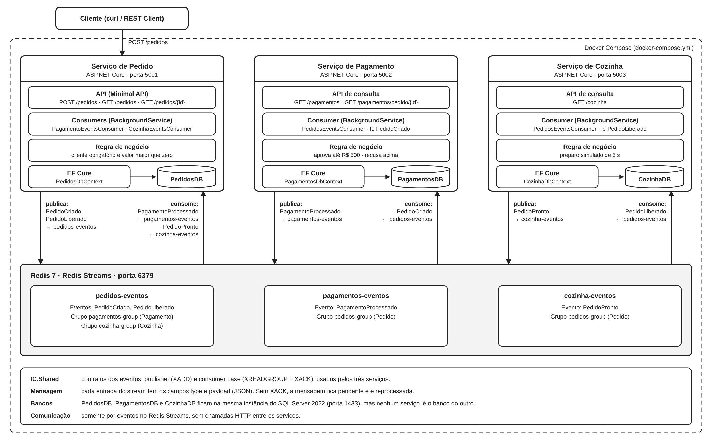
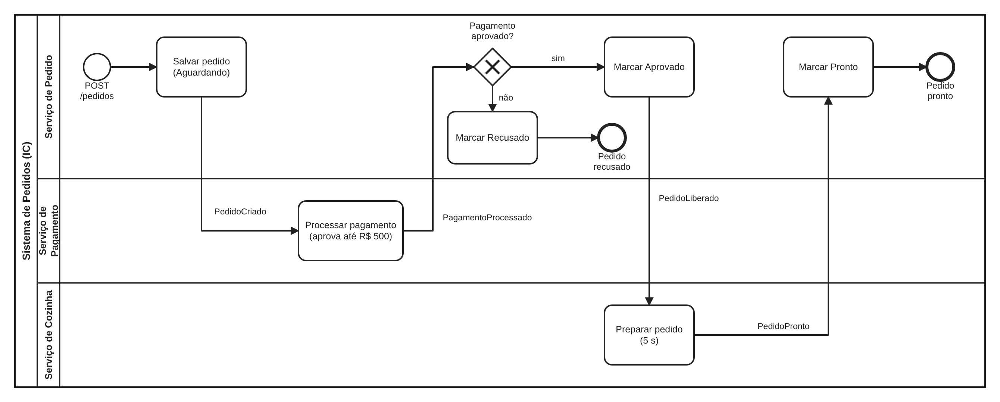

# IC — Microsserviços com .NET, Redis Streams e SQL Server

Sistema de pedidos com **três microsserviços** (Pedido, Pagamento e Cozinha) que se comunicam apenas por
**eventos**, usando **Redis Streams**. Cada serviço tem seu próprio banco no **SQL Server**, acessado com **EF Core**.

Projeto de **Iniciação Científica** desenvolvido em conjunto com a **Fatec Rio Preto**, para estudar a implementação
de microsserviços com Redis no ecossistema .NET. As regras de negócio são simples de propósito.



## Membros

| Nome                  | Papel             |
|-----------------------|-------------------|
| *Murilo Sonsin Rálio* | Aluno pesquisador |
| *Henrique Dezani*     | Orientador        |

## Tecnologias

C# / .NET 10 · ASP.NET Core · Entity Framework Core · SQL Server 2022 · Redis 7 (Streams) · Docker Compose

## Como funciona

| Serviço   | O que faz                                      | Porta | Banco          |
|-----------|------------------------------------------------|-------|----------------|
| Pedido    | Recebe pedidos pela API e acompanha o status   | 5001  | `PedidosDB`    |
| Pagamento | Aprova (até R$ 500) ou recusa o pagamento      | 5002  | `PagamentosDB` |
| Cozinha   | "Prepara" o pedido aprovado (simulado, 5 s)    | 5003  | `CozinhaDB`    |

### Fluxo



As setas entre as raias são eventos publicados no Redis Streams (o nome do evento está na seta).
O diagrama pode ser aberto e editado em [bpmn.io](https://demo.bpmn.io) com o arquivo [`docs/fluxo.bpmn`](docs/fluxo.bpmn).

Streams: `pedidos-eventos`, `pagamentos-eventos` e `cozinha-eventos`. Cada serviço lê pelo seu próprio
*consumer group* e confirma as mensagens com `XACK`.

## Como rodar

Pré-requisito: **Docker** com Docker Compose (no Windows, o Docker Desktop com WSL 2).

Na pasta do `docker-compose.yml`:

```bash
docker compose up --build
```

Na primeira vez demora alguns minutos. Os serviços criam os bancos e as tabelas sozinhos.
Para parar: `docker compose down` (use `-v` para apagar também os dados).

Para testar, use o arquivo `requests.http` (extensão REST Client do VS Code) ou:

```bash
curl -X POST http://localhost:5001/pedidos -H "Content-Type: application/json" \
  -d '{"cliente":"Maria","descricao":"2x Hamburguer","valor":89.90}'

curl http://localhost:5001/pedidos
```

> No cmd do Windows, use aspas duplas com escape: `-d "{\"cliente\":\"Maria\",\"descricao\":\"2x Hamburguer\",\"valor\":89.90}"`.

## Estrutura

```
IC/
├── docker-compose.yml
├── requests.http
├── docs/            diagramas (arquitetura e fluxo BPMN) e registro dos testes
└── src/
    ├── IC.Shared/       eventos e código de Redis Streams compartilhado
    ├── IC.Pedidos/
    ├── IC.Pagamentos/
    └── IC.Cozinha/
```

## Limitações

Simplificações deliberadas, por ser um projeto de estudo: sem Outbox Pattern (o evento pode se perder se o serviço
cair entre salvar e publicar), sem dead-letter, bancos criados com `EnsureCreated` em vez de migrations, e sem
autenticação ou API Gateway.